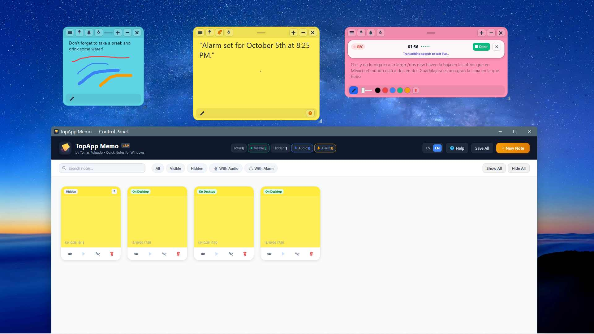
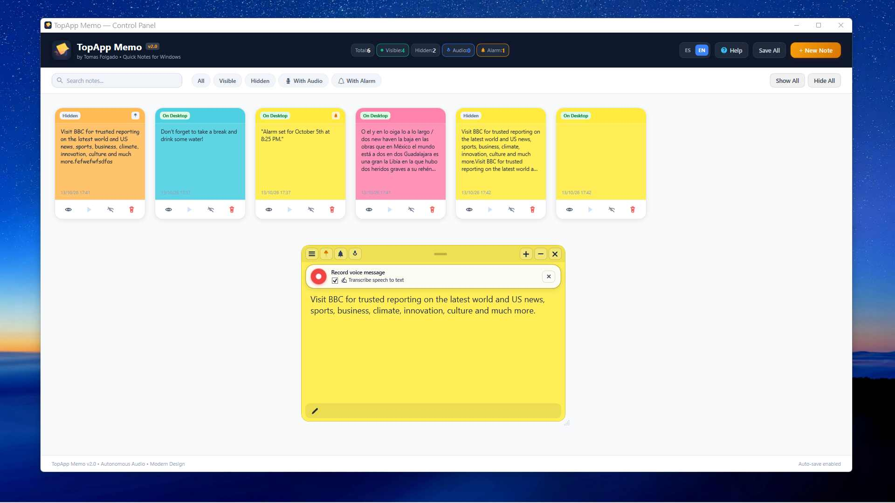
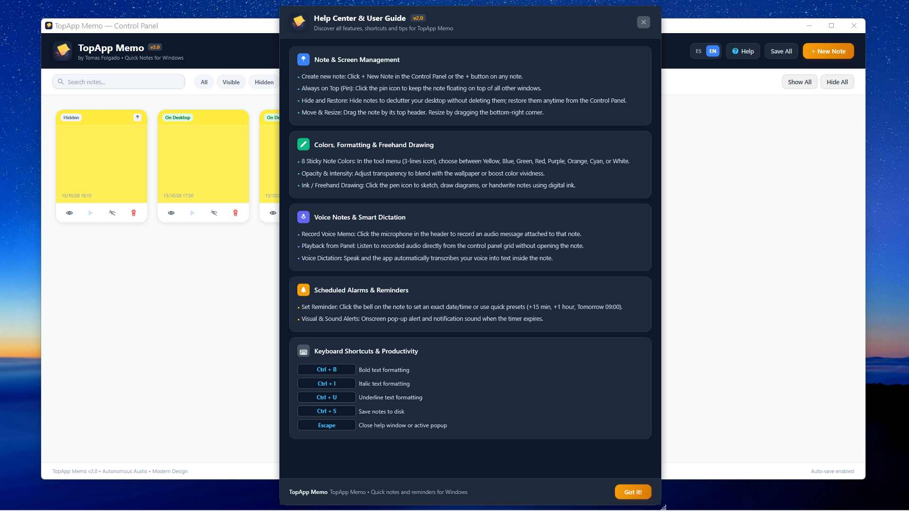
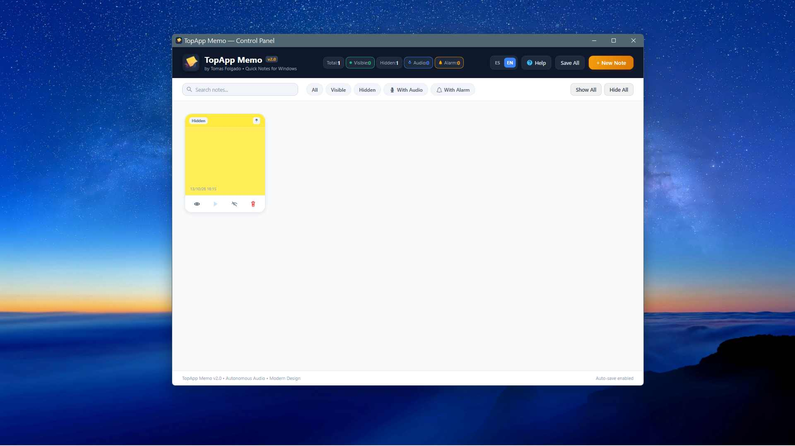

# TopApp Memo

<div align="center">


[](https://www.virustotal.com/gui/file/f83f04b2c26e1efaeabc6463cca7221a9237a1eb09613aaa8a55e93cadb5d42f/detection)

**A modern, lightweight sticky notes application for Windows.**  
*Una aplicación moderna y ligera de notas adhesivas para Windows.*

[English](#english) • [Español](#español) • [Screenshots](#screenshots) • [Security](#security--verification) • [Build & Run](#build-and-run) • [License](#license)

</div>

---

## Screenshots

| Desktop Sticky Notes & Creative Tools | Unified Control Panel & Note Management |
|:---:|:---:|
|  |  |

| Help Center & Shortcuts Guide | Search, Filters & Language Switcher |
|:---:|:---:|
|  |  |

---

## English

### Overview
**TopApp Memo** is a desktop sticky notes manager built with WPF and .NET 8. Designed for focus and productivity, it combines the tactile simplicity of physical notes with digital conveniences such as audio memos, speech-to-text dictation, scheduled alarms, digital ink, and a unified control panel.

### Features

- **Bilingual Interface**: Full English and Spanish localization with instant runtime switching (`ES` / `EN` toggle).
- **Always on Top & Docking**: Pin notes above other windows or keep them on the desktop workspace.
- **Palette & Opacity**: 8 curated post-it colors with fine-grained transparency and color intensity sliders.
- **Digital Ink**: Freehand sketching, diagrams, and handwriting directly on the canvas.
- **Voice Notes**: Integrated audio memo recorder and player attached directly to notes.
- **Speech-to-Text**: Autonomous speech recognition for real-time dictation into the note editor.
- **Scheduled Alarms**: Precise date/time alarms with sound notifications and quick presets (+15m, +1h, tomorrow).
- **Central Control Panel**: Live counters, instant search, status filtering, and bulk management.
- **Keyboard Shortcuts**: Text formatting (`Ctrl+B`, `Ctrl+I`, `Ctrl+U`), saving (`Ctrl+S`), and navigation (`Esc`).

---

## Español

### Descripción
**TopApp Memo** es un gestor de notas adhesivas moderno y ligero desarrollado en WPF (.NET 8). Diseñado para maximizar la productividad diaria, combina la inmediatez de los post-its con funciones digitales avanzadas: notas de voz, dictado inteligente, recordatorios con alarma, dibujo a mano alzada y panel centralizado.

### Características

- **Soporte Bilingüe**: Traducción completa al español e inglés con cambio dinámico e instantáneo (`ES` / `EN`).
- **Siempre al Frente**: Fija notas flotantes por encima de otras aplicaciones con un clic.
- **Paleta y Opacidad**: 8 colores de post-it con ajuste de transparencia e intensidad de color.
- **Tinta Digital**: Modo de dibujo libre para esquemas, firmas y notas manuscritas.
- **Notas de Voz**: Grabación directa por micrófono y reproductor integrado en cada nota.
- **Dictado por Voz**: Transcripción de voz a texto en tiempo real directamente en el editor.
- **Alarmas y Recordatorios**: Programación por fecha/hora con alertas sonoras y accesos rápidos (+15 min, +1 hora, mañana).
- **Panel de Control**: Contadores en vivo, buscador en tiempo real, filtros y acciones globales.
- **Atajos de Teclado**: Formato (`Ctrl+B`, `Ctrl+I`, `Ctrl+U`), guardado (`Ctrl+S`) y cierre rápido (`Esc`).

---

## Build and Run

### Prerequisites
- Windows 10 (version 1809+) or Windows 11
- [.NET 8.0 SDK](https://dotnet.microsoft.com/download/dotnet/8.0)

### Build from Source
```bash
# Clone the repository
git clone https://github.com/tomasfolgado/TopApp-Memo.git
cd TopApp-Memo/PostitApp

# Restore and build in Release mode
dotnet build -c Release

# Publish self-contained executable
dotnet publish -c Release -o ../publish
```

### Run
Launch `TopAppMemo.exe` from `publish/` or `PostitApp/bin/Release/net8.0-windows/`.

---

## Project Structure

```
TopApp-Memo/
├── PostitApp/
│   ├── Assets/              # Icons and application resources
│   ├── Data/                # Local storage (notes.json, settings.json)
│   ├── Helpers/             # Win32 window helpers, MVVM RelayCommands
│   ├── Models/              # Note data model
│   ├── Resources/           # Localization dictionaries (Strings.es.xaml, Strings.en.xaml)
│   ├── Services/            # Note persistence, audio recorder, speech, localization
│   ├── ViewModels/          # MainViewModel, NoteViewModel
│   ├── Views/               # ManagerWindow, NoteWindow, AlarmWindow, HelpWindow
│   └── PostitApp.csproj     # .NET 8 WPF Project specification
├── docs/screenshots/        # UI showcase screenshots
├── .gitignore               # Visual Studio & .NET ignore patterns
├── LICENSE                  # MIT License
└── README.md                # Project documentation
```

---

## Keyboard Shortcuts / Atajos

| Shortcut | Action (English) | Acción (Español) |
|---|---|---|
| `Ctrl + N` | New sticky note | Crear nueva nota |
| `Ctrl + S` | Save notes to disk | Guardar notas en disco |
| `Ctrl + B` | Bold formatting | Formato negrita |
| `Ctrl + I` | Italic formatting | Formato cursiva |
| `Ctrl + U` | Underline formatting | Formato subrayado |
| `Esc` | Close popup or help | Cerrar ventana o diálogo |

---

## Security & Verification / Seguridad

All distributed release files are scanned and verified clean of malware. You can verify the SHA-256 hashes or inspect the public VirusTotal scan reports below:

| File / Archivo | Description | SHA-256 Checksum | VirusTotal |
|---|---|---|:---:|
| `TopAppMemo.exe` | Main Executable | `F83F04B2C26E1EFAEABC6463CCA7221A9237A1EB09613AAA8A55E93CADB5D42F` | [Report](https://www.virustotal.com/gui/file/f83f04b2c26e1efaeabc6463cca7221a9237a1eb09613aaa8a55e93cadb5d42f/detection) |


---

## License

This project is licensed under the **MIT License** — free and open source. See the [LICENSE](LICENSE) file for details.

Developed by **Tomas Folgado**.
